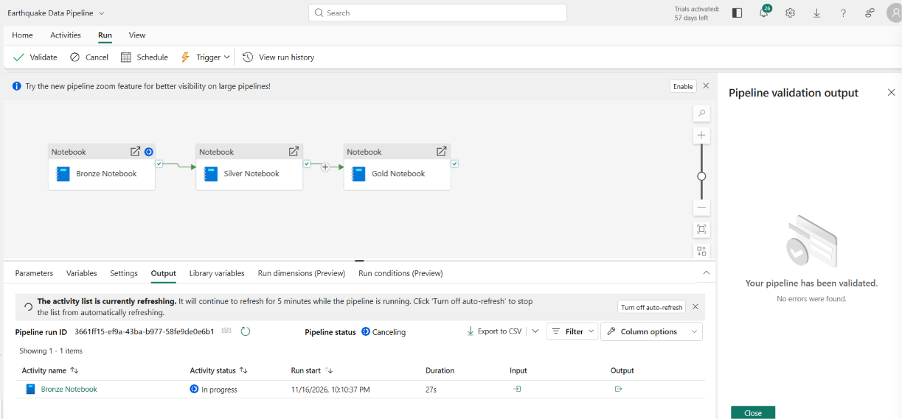

# Data Factory Pipeline Documentation

## Pipeline Execution Workflow

The Microsoft Fabric Data Factory pipeline
orchestrates the execution of three notebooks
using sequential dependencies.

| Activity | Description |
|---|---|
| Bronze Notebook | Fetches and stores raw earthquake data |
| Silver Notebook | Cleans and transforms ingested data |
| Gold Notebook | Generates analytical datasets |
| Orchestration | Manages execution and dependencies |

## Pipeline Execution Screenshot

